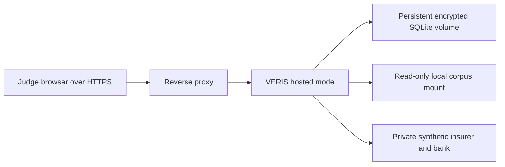

# Deployment guide

## Scope and preconditions

This repository supplies a hosted-mode image and reverse-proxy configuration. It does **not** provision a VM, domain, certificate, account, invite code, provider credit, or hosted demo. A human operator must complete the items in `07-fintechathon/human-actions.md` before making the service available to judges.

Hosted mode requires HTTPS, persistent volumes outside the source checkout, a mounted read-only corpus, and environment/secret-manager values for `VERIS_MASTER_KEY`, `VERIS_RECORD_HMAC_KEY`, `VERIS_JUDGE_INVITE_CODES`, `VERIS_SANDBOX_CLIENT_ID`, `VERIS_SANDBOX_CLIENT_SECRET`, and `VERIS_SANDBOX_SIGNING_KEY`. Do not use a local `.env` file in hosted mode; the application deliberately ignores it.

## Build and local composition

The root `docker-compose.yml` is a **local synthetic** composition:

```powershell
$env:VERIS_LOCAL_CORPUS_DIR = "<absolute path to seeded corpus>"
$env:VERIS_SANDBOX_CLIENT_ID = "<generated local service id>"
$env:VERIS_SANDBOX_CLIENT_SECRET = "<generated local 32-byte URL-safe value>"
$env:VERIS_LOCAL_SANDBOX_ADMIN_TOKEN = "<local-only admin capability>"
docker compose up --build
```

It exposes VERIS on port 8000 and keeps the sandbox private to the compose network. It is not a hosted configuration.

## Hosted topology



Use `docker-compose.hosted.yml` only after a human has created a secret-manager configuration and mounted certificate files at the path expected by `deploy/nginx.conf`:

```powershell
docker compose -f docker-compose.hosted.yml config
docker compose -f docker-compose.hosted.yml up -d --build
```

The first command validates composition only; it does not prove a deployment is reachable. The hosted Compose file places the sandbox only on an internal Docker network with no published port. It pins the reverse proxy to the trusted internal address used by Uvicorn and Nginx overwrites any client-supplied forwarding chain before sending the actual remote address upstream. Do not add another proxy in front of this topology without revisiting those trust settings. Restrict host firewall rules to ports 80 and 443. Do not publish a sandbox port, database path, corpus directory, or secret-manager endpoint.

## Hosted-mode checklist

1. Set `VERIS_MODE` to `hosted`.
2. Provide persistent paths for portfolio, hosted-account, reviewer, and synthetic-sandbox databases outside the repository.
3. Generate distinct master, record-integrity, sandbox-client, and sandbox-signing values in a secret manager. Supply the signing key only to the sandbox service; do not reuse it for VERIS or browser sessions.
4. Create one-time invitation codes for each judge/reviewer and retain them outside git.
5. Mount the verified corpus read-only; run `python scripts/fetch_corpus.py --status` before starting the container.
6. Keep `VERIS_LLM_PROFILE=none` unless consent, provider review, and a spend budget are approved. If a provider is enabled, set tenant/global token budgets and a reviewed outbound hostname allowlist.
7. Terminate TLS at the reverse proxy with current certificates. The application adds HSTS only in hosted mode.
8. Verify `/docs`, `/redoc`, and `/openapi.json` return 404 in hosted mode.
9. Invite a reviewer through the invite-only flow; record credentials outside git before treating an exported label as expert evidence.
10. Define a backup-retention and key-destruction procedure. Local crypto-shredding does not erase provider-managed snapshots.

## Nightly demo reset

A human operator must decide whether the hosted demo is disposable before scheduling a reset. If it is, stop the application, take and verify an encrypted backup only if retention policy permits it, remove only the dedicated demo volumes, then recreate them and verify that no judge account, synthetic sandbox operation, or real document was stored there. Do not apply this procedure to a shared or non-demo volume. Record the operating procedure and a dry run before claiming a nightly reset exists.

## Smoke checks

Install the checkout package before invoking module-style quickstart commands:

```powershell
pip install -r requirements.txt -e .
```

Run after configuration changes:

```powershell
python scripts/smoke_deployment.py
python scripts/scan_repo.py
pip-audit --progress-spinner off
bandit -q -r src -ll
python scripts/check_docs.py
python scripts/verify_evidence.py
```

`smoke_deployment.py` bootstraps the checkout `src/` layout and checks local hosted-mode health, invite signup/login, CSRF, failed and successful first TOTP enrollment, and a TOTP-confirmed action against the private synthetic sandbox HTTP contract. It uses in-process test clients only; it does not contact a public endpoint or prove TLS, DNS, email, provider, or organiser access.
