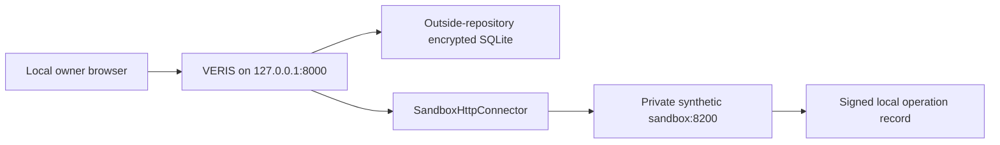

# Local synthetic integration-readiness contract

## Scope

This code-level contract documents VERIS’s controlled local synthetic adapter. It exercises permission, exact-payload, tenant, idempotency, receipt, webhook, and reconciliation controls against a private sandbox. It represents local adapter behavior, not an external integration or production deployment; detailed current scope, interfaces, and validation conditions are in [disadvantages.md](disadvantages.md).

No model decides coverage, settlement, evidence class, premium, or product choice.

## Topology and destination boundary

`src/proven/sandbox_transport.py` accepts only these base URLs for the adapter:

- `http://sandbox:8200` inside Compose;
- `http://localhost:8200`, `http://127.0.0.1:8200`, or `http://[::1]:8200` for an intentional loopback setup.

It rejects HTTPS, other ports/hosts, URL credentials, paths, queries, fragments, and redirects. The local Compose file publishes VERIS only as `127.0.0.1:8000:8000`; the sandbox has no published host port. `scripts/start-local-demo.ps1` likewise binds Uvicorn to `127.0.0.1`.

## Typed action boundary

The deterministic `AgentRuntime` holds a fixed tool registry. Tier 0 observes, tier 1 prepares reversible drafts, tier 2 requires the controls below, and tier 3 has no tool. The synthetic executor supports only registered paths including claim submission/query/dispute preparation, sandbox invoice payment, endorsement request, and cited escalation request.

Before a tier-2 action, the server requires:

1. server-derived SME tenant scope and active consent;
2. a canonical exact payload plus SHA-256 payload hash;
3. password re-entry or enrolled TOTP step-up;
4. a matching live mandate for invoice-payment scope, payee, cap, validity window, and advance notice where applicable; and
5. single-use consumption of the pending confirmation.

The browser receives a canonical preview, not a mutable payload. `Agent Action Receipt` and `/api/evaluation/evidence-export` expose recorded state after the fact; they do not assert that a coverage, claim, settlement, or payment decision was made.

## Synthetic adapter request contract

| Boundary | Actual local contract | Evidence |
| --- | --- | --- |
| Service authentication | Generated local service client id/32-byte secret is exchanged for a tenant-bound bearer token. The browser never receives it. | `sandbox.py`, `sandbox/app.py`, `tests/test_sandbox.py` |
| Tenant isolation | Adapter supplies `X-VERIS-Tenant`; sandbox derives tenant from the bearer token and rejects mismatch. | `sandbox_transport.py`, `sandbox/app.py` |
| Idempotency | Mutating calls carry a deterministic `Idempotency-Key` derived server-side from tool, tenant, and canonical payload. | `api.py`, `sandbox_transport.py`, `tests/test_agent_runtime.py` |
| Webhook integrity | `POST /api/sandbox/webhook` accepts `{event, signature}` only after sandbox HMAC verification, tenant binding, and replay-record insertion. | `api.py`, `sandbox/app.py`, `tests/test_sandbox.py` |
| Receipt/ledger | Tenant-scoped ledger records confirmations, synthetic tool errors/results, and webhook events; HMAC chain, checkpoint, and anchor are verified. | `agent/store.py`, `tests/test_agent_runtime.py` |
| Synthetic operation log | Sandbox operation records are signed, tenant-scoped, checked against checkpoint and separate anchor. | `sandbox.py`, `scripts/verify_evidence.py` |

## Error and retry behaviour

The adapter makes at most **three attempts** for a transport failure (initial attempt plus two retries). It does not retry a sandbox application error such as `404`, `409`, `503`, or another typed sandbox rejection. After repeated transport failure, it opens a 30-second local circuit and returns a synthetic-unavailable error. Redirects are disabled.

`AgentRuntime.confirm()` records `TOOL_ERROR` when an executor raises. A failed action is not presented as success; a user must inspect the error and prepare a fresh permitted confirmation if appropriate. There is no background queue, external webhook delivery service, or recovery worker in this submission.

## Interpretation

The contract demonstrates local adapter controls and recorded synthetic operations. It must not be interpreted as evidence of an external counterparty, production operating environment, money movement, claim decision, or institutional interoperability. [disadvantages.md](disadvantages.md) consolidates the current external-integration, validation, commercial, and operational conditions.

For a repeatable local setup and safety boundary, see [DEMO-RUNBOOK.md](DEMO-RUNBOOK.md). For the complete local test/evidence gate, see [JUDGE-READINESS.md](JUDGE-READINESS.md).
