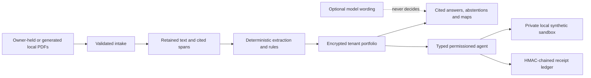

# Judge-readiness package

## What this build demonstrates

VERIS is a local synthetic, evidence-bound insurance workflow demonstration. It reads supplied or generated local documents, keeps page/citation references, applies deterministic rules, stores a tenant-scoped encrypted portfolio, returns cited output or a named review state, and prepares typed synthetic actions only after consent and exact-payload confirmation.

The user-facing **Guided Judge Demo** and **Agent Action Receipt** keep the local/synthetic boundary visible in the app. The receipt reports recorded consent, plan steps, confirmation hash, sandbox result state, and ledger verification.

This is not a real insurer, bank, TPA, payment, claim-approval, claim-submission, settlement, or production service. Deterministic rules, not a model, retain decision ownership for coverage, settlement, evidence class, premium, and product choice. For policy, language, jurisdiction, deployment, and validation conditions, see [current scope and implementation conditions](disadvantages.md).

## Technical architecture



| Layer | Current implementation |
| --- | --- |
| Evidence | `src/proven/ingest.py`, `pipeline.py`, and `corpus.py` retain cited source spans and explicit corpus status. |
| Portfolio | `persistence.py` provides AES-GCM tenant storage outside the repository. |
| Deterministic output | `qa.py`, policy rules, and health/settlement modules produce evidence-grounded output states and calculations. |
| Action | `agent/runtime.py` uses a typed registry, consent, canonical payloads, step-up, and mandates. |
| Counterparty | `sandbox_transport.py` and `sandbox/app.py` provide the private synthetic adapter used by the local demonstration. |
| Evaluation evidence | `/api/evaluation/evidence-export`, the portable record, and the ledger project recorded tenant-scoped evidence. |

See [TECHNICAL.md](TECHNICAL.md) for algorithms, [INTEGRATION-READINESS.md](INTEGRATION-READINESS.md) for the adapter contract, and [disadvantages.md](disadvantages.md) for detailed current scope.

## Five-minute owner demo

Start a clean local instance with:

```powershell
.\scripts\start-local-demo.ps1 -Install -SeedCorpus
```

Open `http://127.0.0.1:8000`, sign in as the listed demo owner, and use only the owner screens. Keep the local/synthetic badges visible.

1. **0:00–0:25 — Scope and preflight.** Open **Portfolio** and click **Check local prerequisites**. State that it reads local configuration, fixture state, and corpus presence only.
2. **0:25–1:10 — Cited question.** Start the labelled synthetic household path. Open Ask VERIS, ask a supported policy question, and show its evidence state, cited source, and any named required document.
3. **1:10–1:40 — Honest abstention.** Ask an outcome question outside the available evidence. Show the missing-evidence/authorised-review state rather than a coverage or payment statement.
4. **1:40–2:35 — Source and preparation.** Open the source drawer, close it with Escape, then prepare the synthetic claim packet and show its checklist/missing-evidence state.
5. **2:35–3:20 — Permission boundary.** Show the exact canonical payload and step-up confirmation. Stop before confirmation unless the private local synthetic sandbox was deliberately configured and rehearsed.
6. **3:20–4:10 — Receipt and evidence export.** Show **Agent Action Receipt**, including pending/not-established values where appropriate, ledger verification, and **Download evaluator evidence (JSON)**. Explain that the export records cited evidence, rule details, missing inputs, and action status.
7. **4:10–5:00 — Close.** Identify the workflow as a controlled local demonstration and direct evaluators to [disadvantages.md](disadvantages.md) for the current scope.

### Repeatable recovery

- If the example is in an unexpected state, use **Reset synthetic example** and enter the displayed confirmation. It removes only server-stamped synthetic records and preserves uploads and ledger history; privacy erase is separate.
- If a wording is unavailable, show the preflight corpus result and the app’s missing-wording state. Do not download a replacement or claim corpus-dependent output was demonstrated.
- If the browser has stale state, close the tab, reopen `http://127.0.0.1:8000`, sign in again, and reload the labelled example. Do not delete the portfolio database as a routine reset.
- If startup was run with the wrong address or environment, stop it with `Ctrl+C` and rerun `scripts/start-local-demo.ps1`; it sets the database outside the repository, disables live sources/model use, and binds only `127.0.0.1`.

## Security risk → control → evidence

| Risk | Control | Local evidence | Remaining boundary |
| --- | --- | --- | --- |
| Unsupported policy or claim statement | Citation binding, deterministic grounding, abstention | `tests/test_qa.py`, `tests/test_source_view.py`, source drawer | Human-authorised review remains required. |
| Evidence drift or unavailable corpus | Manifest hashes, separate outside-Git corpus, named absence | `tests/conftest.py`, `scripts/fetch_corpus.py`, preflight corpus state | Presence is not professional rule review. |
| Tenant/role exposure | Server-derived tenant scope and role routing | `tests/test_auth_roles.py`, `tests/test_portfolio.py`, `tests/test_submission_readiness_api.py` | Hosted account provisioning remains an operating task. |
| Sensitive local records | AES-GCM tenant data keys and outside-repository database | `tests/test_portfolio.py`, `tests/test_persistence_ocr.py` | Backup retention/physical media remain operator responsibilities. |
| Excessive agent authority | Fixed typed registry, consent, exact payload, step-up, mandate checks | `tests/test_agent_runtime.py`, Agent Action Receipt | Tier 2 reaches only the synthetic sandbox; Tier 3 has no tool. |
| Replay or action mutation | Single-use payload hash, idempotency key, HMAC ledger/checkpoint | `tests/test_agent_runtime.py`, `tests/test_sandbox.py`, `tests/test_redteam.py` | This is not a real-counterparty assurance. |
| Redirected or remote sandbox use | Local-only HTTP host/port validation, no redirects, private Compose sandbox | `tests/test_sandbox.py`, `src/proven/sandbox_transport.py` | No carrier/bank interface has been integrated. |
| Prompt injection or PII transport | Untrusted-data origin boundary, redaction, grounding, fixed tools | `tests/test_redteam.py`, `tests/test_redact.py` | Mitigated, not solved; keep model profile `none` for this demo. |
| Local demo exposed on a network | `127.0.0.1` PowerShell start command and loopback Compose port publication | `scripts/start-local-demo.ps1`, `docker-compose.yml`, `tests/test_sandbox.py` | Local mode is deliberately not a hosting posture. |

## Automated evaluation and evidence

Run the deterministic benchmark with `python -m eval.bench --all`. It records fixture-based cited-answer, abstention, agent-plan, and deterministic red-team controls. [EVALUATION.md](EVALUATION.md) and [disadvantages.md](disadvantages.md) describe how to interpret that local evidence.

For a live local inspection, the owner can download `/api/evaluation/evidence-export` from the receipt. The JSON contains only that signed-in tenant’s existing:

- session finding output state, evidence class, citation spans, rule citations, missing inputs, and deterministic detail when present;
- seeded portfolio mechanism/value/evidence fields and synthetic schedule quotations when available;
- stored claim checklist/packet/deadline/settlement-check state; and
- agent consent, pending canonical confirmation previews, HMAC-ledger records, and ledger verification.

The export does not rerun rules, send a request, reveal a secret, or expose a database path.

## Execution-evidence capture checklist

- [ ] Run `scripts/run-release-gate.ps1`; retain its timestamped `%LOCALAPPDATA%\veris-demo\release-gate\...` logs rather than copying generated output into Git.
- [ ] Capture the preflight card, cited answer/source drawer, abstention/missing-document state, packet checklist, exact payload confirmation, and Agent Action Receipt.
- [ ] Download and retain one owner-scoped evaluator-evidence JSON with the matching screenshot; protect it as local portfolio data.
- [ ] If intentionally configured, retain the private synthetic sandbox acknowledgement and ledger verification. Do not label it an insurer response, payment, or claim submission.
- [ ] Capture the reset confirmation and its preservation notice.
- [ ] Record any corpus-dependent skipped tests exactly as shown by pytest (`-ra`); do not convert skips into passes.

## Demonstrated evaluator evidence

| Review topic | Current evidence |
| --- | --- |
| Inspectable findings | Citation spans, evidence state, missing inputs, deterministic details, source drawer, and evaluator-evidence export. |
| Evidence-aware responses | Explicit abstention states and named required documents. |
| Accountable actions | Consent, exact payload, step-up, mandate checks, idempotency, receipt, and ledger verification. |
| Controlled interoperability workflow | Typed local adapter, tenant token, webhook HMAC/replay guard, bounded retry, and documented contract. |
| Reusable wording workflow | Manifest-driven wording onboarding, separate corpus status, and deterministic corpus-dependent test reporting. |
| Evidence-led review experience | Provenance, uncertainty states, and controlled adviser handoff in the local workflow. |

For the detailed policy, language, operational, validation, and commercial conditions of the current build, use [disadvantages.md](disadvantages.md).

## Local release commands

```powershell
.\scripts\run-release-gate.ps1
```

The gate runs the complete pytest suite, deployment smoke, JavaScript syntax checks, repository scan, i18n, dependency audit, Bandit, deterministic red-team, evaluation benchmark, compliance check, documentation check, and evidence verification. Its output is outside the repository, and it records rather than hides corpus state and skips.

For a direct test diagnosis, the same suite command is:

```powershell
python -m pytest -q -p no:warnings
```
