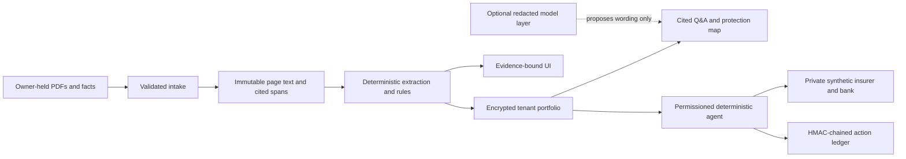

# Technical documentation

## Purpose and boundary

VERIS is an evidence-bound insurance agent for a household and small-business portfolio. It reads supplied policy material, returns page-cited terms, maps documented gaps and overlaps, prepares synthetic claim work, and records actions under a permission tier. It does **not** decide whether cover exists, decide whether a claim will be paid, recommend insurance products, calculate premiums, or make a real payment.

The optional model layer is not in the decision path. `resolve.py`, `arithmetic.py`, `grading.py`, and `score.py` do not import it; tests hold that import direction.

## Core algorithms

### Evidence grading and abstention

Each source is classified from document authorship, not a caller-supplied label: `PROVEN`, `DECLARED`, `MARKET_CONVENTION`, or `UNESTABLISHED`. Owner-facing output has four states only: `DOCUMENTED`, `NOT_CONFIRMED`, `INFORMATION_MISSING`, and `REQUIRES_AUTHORISED_REVIEW`. Missing operands produce no substituted number and name the document that would establish the operand.

### Propose → verify → bind

Candidate clauses are proposed from sentence structure. Deterministic verification checks mandatory and negative slots before a candidate becomes a bound mechanism. Stored spans carry page number, offsets, quoted text, and a hash; the citation audit checks that the quote still reproduces at those offsets.

### Jurisdiction detection

The detector weighs a governing-law clause first, then regulator/statute terms, currency, identifiers, postcodes, and phone formats. It requires either governing-law evidence or corroboration from independent signal types. Ambiguity falls back to `GENERIC`; no other country’s rule is silently applied. Pack rules contain a verification status, source URL, retrieval date, quote, and verifier where available. Packs exist for Singapore, India, Hong Kong, Malaysia, and mainland China; a recognised country without a pack is read under `GENERIC` with a notice naming the missing pack.

### Settlement arithmetic and deadlines

Money is `Decimal`, never binary floating point. Health illustrations expose each operand and evidence class, refuse missing inputs, and label convention-based ordering as an illustration. The claim deadline engine uses policy timezone, documented timing, and jurisdiction holiday calendars; it does not state an unstated consequence of missing a deadline.

### Agent policy engine

The deterministic planner maps explicit owner intent to a fixed registry of typed tools. Tier 0 observes; tier 1 prepares reversible drafts; tier 2 requires an exact payload hash plus step-up authentication or a matching mandate; tier 3 has no tool. The tenant-bound ledger records plans, confirmations, tool calls, and results through an HMAC chain and protected checkpoint.

### Redaction and grounding

Before optional provider transport, recognised names, contact details, identity numbers, policy/claim identifiers, bank details, and addresses are replaced by reversible server-side tokens. Images are never sent. Model wording is discarded if it introduces unsupported numbers or dates, outcome/advice language, missing citations, or a tool action not bound to explicit user intent.

## Security design

Hosted mode requires login for every workspace route, uses invite-only accounts, 600000-round PBKDF2-SHA256, account lockout, account-and-client rate limiting, double-submit CSRF, Secure/HttpOnly/SameSite session cookies, HSTS, disabled interactive API documentation, request bounds, and an outbound HTTPS hostname allowlist. A hosted account re-enters its own password through the durable hosted-account store before first TOTP enrollment; existing TOTP can then satisfy later step-up checks. The fixed-address reverse proxy removes any client-supplied forwarding chain, and Uvicorn trusts forwarded client identity only from that proxy. Untrusted PDF extraction runs in a separate process with a wall-clock limit and a Linux address-space limit. Local mode preserves offline demo conveniences and is not a hosting posture.

Tenant data is encrypted at rest with AES-GCM. The portfolio, agent controls, and reviewer labels have separate stores and tenant scope. A portable fact chain remains independently structurally verifiable; hosted exports receive an additional server-held HMAC over the canonical export.

## Counterparty and evidence topology

The sandbox insurer and bank are separate private synthetic FastAPI surfaces with generated service credentials, tenant-bound access tokens, idempotency keys, signed webhooks, a controllable clock, and signed JSONL operations. Local and hosted Compose place it on a private service network with no published sandbox port; hosted mode gives its signing key only to the sandbox container. They are synthetic artefacts only. The evidence viewer never renders a full page from a third-party corpus document; it shows an exact cited paragraph plus a publisher link.

## Built after submission v1

Each item below is implemented locally with targeted tests and keeps the boundaries above: no model decision, `Decimal` money, cited evidence, the four output states, tenant isolation, and the local-only sandbox.

- **India motor penalty (status).** The motor card and third-party expiry alert are built. The Motor Vehicles Act section 196 penalty stays withheld: the pack entry is `CANDIDATE` because no current consolidated primary text could be machine-verified, so no penalty figure, date, or consequence is shown.
- **Renewals and payment under mandate.** `renewals.py` gives a tenant-scoped renewal calendar, countdowns from documented dates, the compulsory motor alert, and an owner-held prior/current document diff that reuses the deterministic renewal engine. A scheduler may run tier 0/1 work; it may pay a sandbox insurer invoice only inside a matching live mandate (scope, payee allowlist, per-payment cap, validity window, advance notice), and confirmation plus step-up still apply.
- **Motor claims.** The claims copilot covers synthetic motor own-damage: a cited checklist, packet roles, a withheld deadline where no clause states one, and the counterparty-owned surveyor transition delivered by signed webhook.
- **Privacy and delegation.** Encrypted consent artefacts (purpose, data categories, recipient, duration, revocation); adult-member consent before health data is used; a scoped, time-limited delegate who can prepare one consented member's claim but cannot submit, decide, or pay; retention settings; tenant export; and a step-up-protected crypto-shred. Country privacy notices appear only from a source-quoted pack entry.
- **Interaction layer.** An installable shell whose service worker precaches a fixed list of public `/static/` files, network-first, and never stores an `/api/` response, a navigation, or a non-GET request; sign-out clears its caches. Camera capture feeds the existing upload pipelines (claim photos are encrypted claim evidence; a photographed document becomes a one-page PDF that intake reports as having no text layer rather than guessing). Accessibility work covers contrast, visible focus, keyboard parity, a live agent trace, and reduced motion. A guided household tour and a tenant-scoped, idempotent demo reset that removes only server-stamped synthetic records.
- **Home and travel.** Structural home and travel mechanisms (sum-insured basis, contents, forcible-entry theft, unoccupancy, notice; trip cancellation, overseas medical, baggage-delay threshold, carrier report, existing-condition exclusion, claim notice) bound on public wordings. The household's contents sum insured is compared with its self-declared contents list as a `DECLARED` illustration with both operands cited, never an amount payable.
- **Hong Kong, Malaysia, and the GENERIC showcase.** HK and MY packs with their own currency, timezone, holidays, document authorship, and detection signals. Statutes and regulators whose primary text could not be fetched are `CANDIDATE`; owner-facing entries are limited to two machine-checked quotes. VHIS Standard Plan mechanisms bind on the government's template. HKID (mod-11 check) and MyKad (real birth date) numbers are redacted. A public wording from a country with no pack is detected, read, and quoted with no legal statement.
- **Simplified Chinese and the China pack.** A dictionary-free character-bigram tokenizer (a segmenter was rejected because its output moves with its dictionary), Chinese numerals, renminbi amounts including 万, 亿 and written 大写 amounts, year-first dates, and 第…条/款 clause numbers. Every guard applies every language's outcome and advice lexicon, and the grounding gate rejects an unsupported figure written in Chinese numerals. The deepseek and qwen profiles receive a Chinese system prompt for a Chinese question; other profiles keep the English prompt. Mainland resident identity numbers (ISO 7064 check), mobiles, and labelled names and addresses are redacted. OCR reports `chi_sim` only when the installed engine lists it. The zh-CN catalogue covers owner screens; adviser, insurer, and reviewer screens stay English and say so, and `scripts/check_i18n.py` enforces that scope. The China pack shows an owner only the regulator's complaint hotline, quoted from its own HTTPS site; law articles read only over plain HTTP remain `CANDIDATE`.

## Deliberate non-features and roadmap

### Evidence anchoring on a consortium chain (design only — not implemented)

This release contains no chain client, contract, deployment, or on-chain claim. The design, recorded so the gate can be reviewed:

- **Chain and transport.** FISCO BCOS 3.x, reached either through WeBASE-Front's REST API or through a small Python 3.10 sidecar process. The sidecar exists because the chain's Python SDK supports Python 3.6–3.10 while VERIS runs on 3.12; it would hold the anchoring account's key in its own process and expose one local, authenticated interface to VERIS.
- **What is anchored.** Claim-packet manifests (already a SHA-256 manifest of per-document hashes), consent-artefact metadata hashes (purpose, categories, recipient, duration, and revocation state, never their content), and agent-ledger checkpoints (the HMAC chain head and sequence number).
- **What goes on chain.** Only Merkle roots and metadata hashes. Leaves are salted per tenant with a salt kept off chain, so identical documents in two tenants do not correlate and a crypto-shred that destroys the salt leaves nothing linkable. No personal data, tenant identifier, or document text is ever written.
- **Contract.** An `EvidenceAnchor` contract with one append-only write (root, metadata hash, period end) restricted to an allowlisted anchoring account, an event per anchor, and a read-only lookup by root.
- **Verification.** A "verify on chain" screen recomputes the leaf from the local artefact, shows its Merkle path and root, and looks the root up on chain. Anchoring is asynchronous and never gates a claim, payment, or consent action; an artefact without an anchor is shown as not anchored, never as invalid.

See [SECURITY-SELF-ASSESSMENT.md](SECURITY-SELF-ASSESSMENT.md), [COMPLIANCE.md](COMPLIANCE.md), [EVALUATION.md](EVALUATION.md), and [DEPLOYMENT.md](DEPLOYMENT.md).
