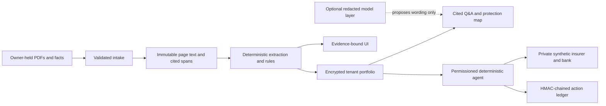

# Technical documentation

## Purpose and boundary

VERIS is an evidence-bound insurance agent for a household and small-business portfolio. It reads supplied policy material, returns page-cited terms, maps documented gaps and overlaps, prepares synthetic claim work, and records actions under a permission tier. It does **not** decide whether cover exists, decide whether a claim will be paid, recommend insurance products, calculate premiums, or make a real payment.

The optional model layer is not in the decision path. `resolve.py`, `arithmetic.py`, `grading.py`, and `score.py` do not import it; tests hold that import direction.

## Core algorithms

### Evidence grading and abstention

Each source is classified from document authorship, not a caller-supplied label: `PROVEN`, `DECLARED`, `MARKET_CONVENTION`, or `UNESTABLISHED`. Owner-facing output has four states only: `DOCUMENTED`, `NOT_CONFIRMED`, `INFORMATION_MISSING`, and `REQUIRES_AUTHORISED_REVIEW`. Missing operands produce no substituted number and name the document that would establish the operand.

### Propose → verify → bind

Candidate clauses are proposed from sentence structure. Deterministic verification checks mandatory and negative slots before a candidate becomes a bound mechanism. Stored spans carry page number, offsets, quoted text, and a hash; the citation audit checks that the quote still reproduces at those offsets.

### Jurisdiction detection

The detector weighs a governing-law clause first, then regulator/statute terms, currency, identifiers, postcodes, and phone formats. It requires either governing-law evidence or corroboration from independent signal types. Ambiguity falls back to `GENERIC`; no other country’s rule is silently applied. Pack rules contain a verification status, source URL, retrieval date, quote, and verifier where available.

### Settlement arithmetic and deadlines

Money is `Decimal`, never binary floating point. Health illustrations expose each operand and evidence class, refuse missing inputs, and label convention-based ordering as an illustration. The claim deadline engine uses policy timezone, documented timing, and jurisdiction holiday calendars; it does not state an unstated consequence of missing a deadline.

### Agent policy engine

The deterministic planner maps explicit owner intent to a fixed registry of typed tools. Tier 0 observes; tier 1 prepares reversible drafts; tier 2 requires an exact payload hash plus step-up authentication or a matching mandate; tier 3 has no tool. The tenant-bound ledger records plans, confirmations, tool calls, and results through an HMAC chain and protected checkpoint.

### Redaction and grounding

Before optional provider transport, recognised names, contact details, identity numbers, policy/claim identifiers, bank details, and addresses are replaced by reversible server-side tokens. Images are never sent. Model wording is discarded if it introduces unsupported numbers or dates, outcome/advice language, missing citations, or a tool action not bound to explicit user intent.

## Security design

Hosted mode requires login for every workspace route, uses invite-only accounts, 600000-round PBKDF2-SHA256, account lockout, account-and-client rate limiting, double-submit CSRF, Secure/HttpOnly/SameSite session cookies, HSTS, disabled interactive API documentation, request bounds, and an outbound HTTPS hostname allowlist. A hosted account re-enters its own password through the durable hosted-account store before first TOTP enrollment; existing TOTP can then satisfy later step-up checks. The fixed-address reverse proxy removes any client-supplied forwarding chain, and Uvicorn trusts forwarded client identity only from that proxy. Untrusted PDF extraction runs in a separate process with a wall-clock limit and a Linux address-space limit. Local mode preserves offline demo conveniences and is not a hosting posture.

Tenant data is encrypted at rest with AES-GCM. The portfolio, agent controls, and reviewer labels have separate stores and tenant scope. A portable fact chain remains independently structurally verifiable; hosted exports receive an additional server-held HMAC over the canonical export.

## Counterparty and evidence topology

The sandbox insurer and bank are separate private synthetic FastAPI surfaces with generated service credentials, tenant-bound access tokens, idempotency keys, signed webhooks, a controllable clock, and signed JSONL operations. Local and hosted Compose place it on a private service network with no published sandbox port; hosted mode gives its signing key only to the sandbox container. They are synthetic artefacts only. The evidence viewer never renders a full page from a third-party corpus document; it shows an exact cited paragraph plus a publisher link.

## Deliberate non-features and roadmap

Blockchain anchoring is design-only. A future integration would place only Merkle roots and metadata hashes on a chain through a separate compatible service, never personal data. It would anchor claim-packet manifests, consent artefacts, and ledger checkpoints, then provide a verification view. No chain client, contract, deployment, or on-chain claim is included in this release.

See [SECURITY-SELF-ASSESSMENT.md](SECURITY-SELF-ASSESSMENT.md), [COMPLIANCE.md](COMPLIANCE.md), [EVALUATION.md](EVALUATION.md), and [DEPLOYMENT.md](DEPLOYMENT.md).
